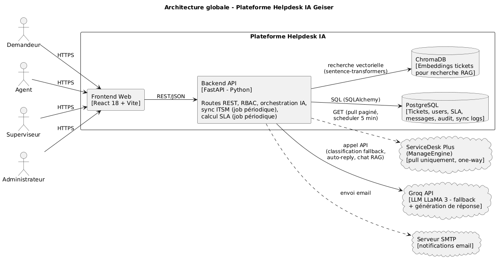
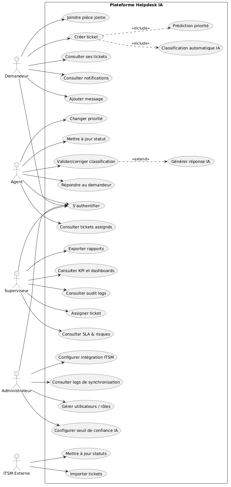
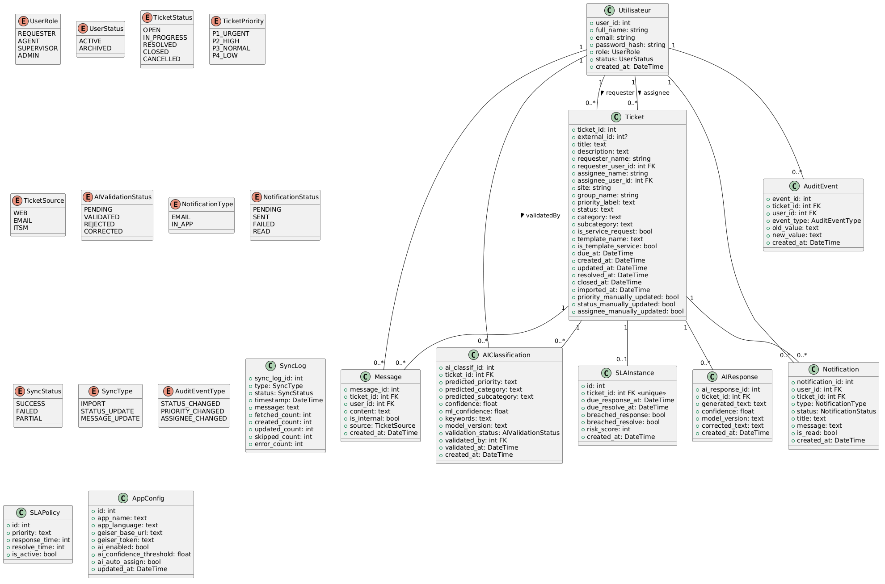
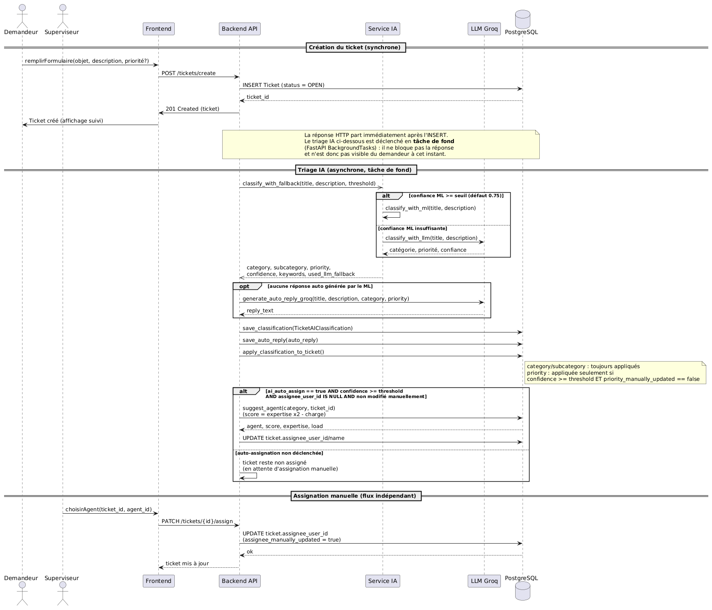
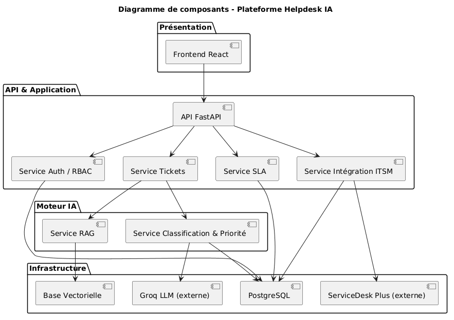

# Helpdesk IA — AI-Powered Support Ticket Platform

End-of-studies engineering project (Data Science, ESPRIT 2026), built during an internship at **GEISER**.

A full-stack platform that automates the life cycle of IT support tickets — **intake, classification, prioritization, routing and follow-up** — by combining classical machine learning, LLMs and retrieval-augmented generation. The project follows the **CRISP-DM** methodology, from data exploration in notebooks to models served in production.

> **Note on data:** this repository contains **source code only**. No company data, real tickets, database dumps, trained models or vector store are included, for confidentiality reasons. The notebooks are published without their outputs.



## Features

### AI
- **Hybrid ticket classification** (category, sub-category, priority): TF-IDF + LinearSVC / XGBoost, with an **LLM fallback** (Groq) when the model's confidence is below 75%.
- **OCR on attachments** (EasyOCR): text extracted from screenshots enriches the classifier input.
- **Automatic routing** to the most relevant agent (expertise scoring), with a fallback on historical per-category rules.
- **RAG assistant** (ChromaDB + multilingual sentence embeddings) that retrieves similar resolved tickets.
- **Agentic chatbot** that performs real actions on the platform through tool calling.
- **Predictive analytics**:
  - SLA breach risk (Gradient Boosting)
  - Anomaly detection (Isolation Forest)
  - Recurring-topic clustering (KMeans)
  - Ticket volume forecasting (Prophet)

### MLOps & observability
- **MLflow** experiment tracking and model registry; production loads models via the `@champion` alias, with a transparent fallback on local artifacts.
- Manual retraining pipeline on agent-validated tickets (`scripts/retrain_scheduled.py`), which writes candidate models without overwriting production.
- **Elasticsearch + Kibana** dashboard monitoring AI classifications.

### Platform
- JWT authentication + email OTP + password reset.
- Role-based access control: Admin, Supervisor, Agent, Requester — one dashboard per role.
- SLA tracking with automatic breach detection and escalation.
- In-app and email notifications, audit log, PDF export.
- Periodic synchronization with an external ServiceDesk.
- Ticket attachments (upload / download).

## Tech stack

| Layer | Technologies |
|---|---|
| Backend | Python, FastAPI, SQLAlchemy, Alembic, PostgreSQL |
| Frontend | React 18, Vite, Nginx |
| ML / NLP | scikit-learn, XGBoost, Prophet, EasyOCR, sentence-transformers |
| LLM / RAG | Groq API, ChromaDB |
| MLOps | MLflow (tracking + model registry) |
| Observability | Elasticsearch, Kibana |
| Deployment | Docker, Docker Compose |
| Tests | pytest (90+ tests) |

## Project structure

```
├── backend/
│   ├── app/
│   │   ├── routers/        # auth, users, tickets, sla, notifications, settings, ai
│   │   ├── services/       # AI service, RAG, SLA, sync, notifications, ES sync
│   │   ├── models/         # SQLAlchemy models
│   │   └── schemas/        # Pydantic schemas
│   ├── alembic/            # database migrations
│   ├── notebooks/          # CRISP-DM notebooks (exploration → classification → routing → RAG → predictive)
│   └── tests/              # pytest suite
├── frontend/src/           # React app (4 role-based dashboards)
├── scripts/                # data import, labeling, retraining
├── docs/diagrams/          # UML & architecture diagrams
└── docker-compose.yml      # db, backend, frontend, mlflow, elasticsearch, kibana
```

## Getting started

```bash
cp .env.example .env      # then fill in your own values
docker compose up --build
```

- Frontend: http://localhost
- API docs: http://localhost:8000/docs

**Without the trained models and the vector store** (not included), you need to:
1. Provide your own labeled ticket dataset in `data/`.
2. Run the notebooks in `backend/notebooks/` in order to train the models and build the RAG index.

The LLM fallback still works as long as a Groq API key is set.

## Diagrams

| | |
|---|---|
|  |  |
|  |  |

## Author

**Ranim Benali** — Data Science Engineer
[LinkedIn](https://www.linkedin.com/in/benaliranim) · [GitHub](https://github.com/ranimbenali)
